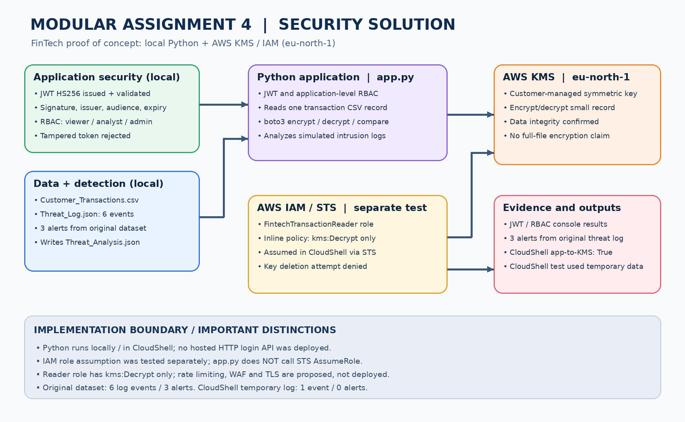

# Security Solution — Modular Assignment 4

**FinTech cloud security proof of concept** | Python · AWS KMS · boto3 · JWT · IAM/STS · RBAC · Threat analysis

This project addresses the university Modular Assignment 4 security requirements using simulated financial transactions and intrusion logs. It demonstrates application authentication/authorization, real AWS KMS encryption, cloud IAM least privilege, and suspicious-event analysis.

## Architecture



**[Architecture image](docs/M4-Architecture.png)** · **[Final three-page report](docs/Security%20Solution-M4-Report.docx)**

### Scope and deployment

`app.py` runs locally or in AWS CloudShell; AWS KMS and IAM are cloud services in **eu-north-1**. The application **does not** deploy a hosted HTTP API. JWT verification and application RBAC run locally. The `FintechTransactionReader` IAM role was assumed and tested **separately in CloudShell**; `app.py` does not invoke STS AssumeRole. The reader role allows **kms:Decrypt only**. Rate limiting, WAF, TLS and automatic IP blocking are proposed production controls, not deployed mitigations.

## Project files

| File | Purpose |
|---|---|
| `app.py` | JWT validation, RBAC, threat analysis, AWS KMS encrypt/decrypt |
| `Customer_Transactions.csv` | Synthetic transaction records |
| `Threat_Log.json` | Six simulated security events |
| `Threat_Analysis.json` | Three generated alerts from the original log |
| `requirements.txt` | Python dependencies |
| `docs/M4-Architecture.png` | Accurate security architecture diagram |
| `docs/Security Solution-M4-Report.docx` | Consolidated report (max. three pages) |
| `docs/M4-09-Full-Application-KMS-Test.png` | CloudShell full application + AWS KMS test |

## Quick start

Install Python 3.10+ and dependencies:

```bash
python -m pip install -r requirements.txt
```

Set a strong **temporary** JWT secret (PowerShell):

```powershell
$env:DEMO_JWT_SECRET = [Convert]::ToBase64String([Security.Cryptography.RandomNumberGenerator]::GetBytes(32))
python app.py
```

The first run tests JWT, application RBAC and the original threat log; it intentionally skips KMS unless a key is supplied. To test KMS, use authorized AWS credentials in `eu-north-1` and run:

```powershell
$env:AWS_DEFAULT_REGION = 'eu-north-1'
python app.py --kms-key-id 'YOUR_KMS_KEY_ID'
```

The program encrypts/decrypts **one CSV transaction record** with KMS and checks plaintext equality; it does **not** encrypt the whole CSV file. Never commit credentials, JWT secrets or tokens.

## Test results

| Security test | Observed outcome |
|---|---|
| JWT valid token | Accepted |
| Tampered JWT | Rejected |
| Viewer `read` / `manage` | ALLOW / DENY |
| Original threat log | 6 events → **3 alerts** |
| boto3 AWS KMS encrypt/decrypt | Passed, original bytes recovered |
| AWS IAM reader role | STS assumption + decrypt succeeded; key deletion denied |
| Complete `app.py` to AWS KMS | **Passed:** 249 ciphertext bytes; `AWS KMS decryption matches original: True` |

**Evidence:** [Full application-to-KMS screenshot](docs/M4-09-Full-Application-KMS-Test.png).

**Test-data distinction:** The full CloudShell integration test used temporary synthetic CSV and threat-log files because upload was rate-limited; its log contained 1 event and produced 0 alerts. The original six-event threat log was tested locally and generated 3 alerts. These are separate, consistent tests.

## Threat detection and mitigation

| Threat | Detection | Mitigation status |
|---|---|---|
| Repeated failed logins (3 from one IP) | Alert | Rate limiting / temporary block **recommended** |
| Unauthorized access | `access_denied` alert | RBAC deny **demonstrated** |
| Suspicious payload | `suspicious_payload` alert | Input validation / WAF **recommended** |
| Transaction data disclosure | AWS KMS round trip | Encryption/decryption of one sample record **demonstrated** |

The analysis output is saved as [`Threat_Analysis.json`](Threat_Analysis.json). No live intrusion-prevention system is deployed.

## Documentation and evidence

- [Final three-page report](docs/Security%20Solution-M4-Report.docx)
- [Security architecture diagram](docs/M4-Architecture.png)
- [01 — AWS KMS customer-managed key](docs/M4-01-AWS-KMS-Encryption.png)
- [02 — AWS KMS CLI encryption](docs/M4-02-AWS-KMS-Encryption.png)
- [03 — AWS KMS CLI decryption](docs/M4-03-AWS-KMS-Decryption.png)
- [04 — Local JWT, RBAC and threat dashboard](docs/M4-04-JWT-RBAC-Threat-Analysis.png)
- [05 — AWS SDK boto3 encryption test](docs/M4-05-AWS-SDK-Encryption-Test.png)
- [06 — AWS KMS key administrator and user configuration](docs/M4-06-AWS-IAM-RBAC-Permissions.png)
- [08 — IAM reader-role permission validation](docs/M4-08-IAM-RBAC-Validation.png)
- [09 — Complete app.py integration with AWS KMS](docs/M4-09-Full-Application-KMS-Test.png)
- [Generated threat analysis](Threat_Analysis.json)

## Limitations and cleanup

This is a proof of concept, not a production transaction platform. A production deployment would need hosted APIs, TLS, WAF/rate limiting, monitoring, persistent encrypted storage, audit logging and formal key lifecycle management. A customer-managed AWS KMS key may incur charges until deletion is scheduled and the waiting period completes. **Only schedule deletion if this key is dedicated to the assignment and no longer needed.**
